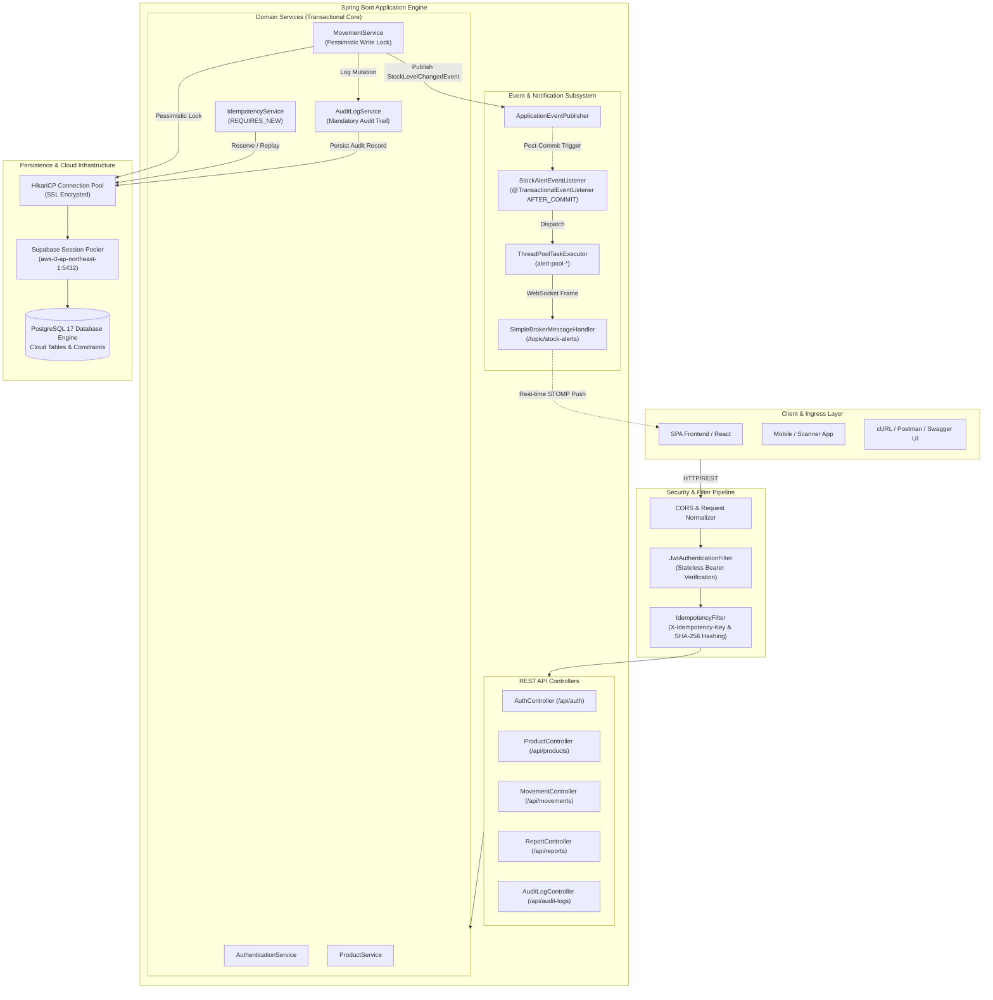
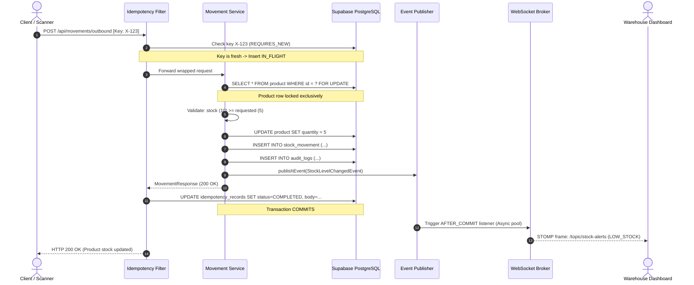

# High-Level Design (HLD) - Smart Warehouse Management Engine

## 1. Executive Overview

The **Smart Warehouse Management Engine** is an enterprise-grade, high-throughput backend service built with **Spring Boot 3.5** and **Java 17**, backed by a cloud-hosted **PostgreSQL** database on **Supabase**. The platform provides centralized warehouse inventory management, concurrency-safe stock mutations, idempotent transaction processing, audit logging, and real-time STOMP/WebSocket alerts for inventory threshold events.

The architecture is specifically engineered to eliminate common distributed systems failure modes:
1. **Lost Updates & Negative Inventory**: Prevented via database-level **Pessimistic Locking (`SELECT ... FOR UPDATE`)**.
2. **Double-Deductions on Network Retries**: Prevented via an **Idempotency Engine** enforcing payload hashing and database uniqueness constraints.
3. **Ghost WebSocket Alerts on Failed Transactions**: Prevented by decoupling notifications into **Transaction-Bound Event Listeners (`AFTER_COMMIT`)** executing on dedicated asynchronous thread pools.

---

## 2. High-Level Architecture Diagram

---

## 3. Core System Components

### 3.1 Client & Ingress Layer
- **Web SPA (React/Vite)**: Warehouse staff UI for tracking inventory, receiving real-time stock alert banners, and executing inbound/outbound adjustments.
- **REST & Swagger UI**: Exposes OpenAPI 3.0 documentation with interactive Bearer JWT authorization at `/swagger-ui.html`.
- **WebSocket STOMP Handshake**: Authenticated STOMP client connecting to `/ws` with channel subscription at `/topic/stock-alerts`.

### 3.2 Security & Filter Pipeline
- **Stateless JWT Authentication**: Validates HMAC-SHA256 signatures on incoming Authorization headers. No server session state is retained.
- **Role-Based Access Control (RBAC)**: Enforces role permissions across three tiers:
  - `ADMIN`: Full access to user management, settings, audit logs, and stock movements.
  - `MANAGER`: Management of products, suppliers, stock movements, and reports.
  - `EMPLOYEE`: Read-only queries and recording stock movements.
- **Idempotency Interception**: Inspects `X-Idempotency-Key` headers on mutating requests (`POST`, `PUT`, `PATCH`). Computes SHA-256 request payload hashes, short-circuiting duplicate executions and returning cached responses.

### 3.3 Domain Business Engine
- **Stock Movement Engine**: Orchestrates stock mutations (`INBOUND`, `OUTBOUND`, `ADJUSTMENT`). Manages quantity snapshots (`beforeQuantity`, `afterQuantity`), checks min/max constraints, and publishes domain events.
- **Pessimistic Lock Coordinator**: Employs `@Lock(LockModeType.PESSIMISTIC_WRITE)` to place an exclusive row lock (`FOR UPDATE`) on the target product record prior to checking quantity.
- **Audit Logging Subsystem**: Synchronously writes an immutable ledger entry for every mutating action, recording timestamp, entity type, ID, actor, and summary details in the same transaction.

### 3.4 Event & Notification Engine
- **Transaction-Bound Event Decoupling**: Rather than triggering notification side-effects directly within service methods, services publish `StockLevelChangedEvent`.
- **`AFTER_COMMIT` Phase Gate**: Spring's `@TransactionalEventListener(phase = TransactionPhase.AFTER_COMMIT)` ensures alerts are only emitted once the PostgreSQL transaction has completed its durability commit.
- **Dedicated Thread Pool**: WebSocket serialization and transport run on an isolated `ThreadPoolTaskExecutor` (`alert-pool-*`), preventing notification latency from impacting HTTP API response times.

### 3.5 Cloud Persistence Layer
- **Supabase Cloud PostgreSQL**: Managed PostgreSQL 17 database running in AWS Tokyo (`ap-northeast-1`).
- **Supavisor Session Pooling**: Communicates through Supabase's IPv4-compatible connection pooler on port 5432 with mandatory SSL (`sslmode=require`).
- **HikariCP Pool**: High-performance JDBC connection pool configured with strict connection limits tailored for cloud database tiering.

---

## 4. System Topology & Data Flow

---

## 5. Non-Functional Architecture & Resilience Guarantees

| Requirement | Architectural Solution |
|---|---|
| **Zero Inventory Race Conditions** | Row-level `PESSIMISTIC_WRITE` locks in PostgreSQL enforce strict serializability on concurrent mutations of the same SKU. |
| **Network Retry Safety** | Client-provided idempotency keys combined with SHA-256 payload digests prevent duplicate execution if mobile scanners or clients retry after timeouts. |
| **Notification Consistency** | `@TransactionalEventListener(phase = AFTER_COMMIT)` prevents false alerts during transaction rollback or database exceptions. |
| **Audit Compliance** | Transactional audit records stored synchronously in the same database transaction guarantees zero untracked state mutations. |
| **Thread Isolation** | Dedicated `ThreadPoolTaskExecutor` prevents WebSocket push operations from starving HTTP request threads. |
| **Transport Security** | All database connections require TLS (`sslmode=require`), and all REST endpoints require signed JWT bearer tokens. |
