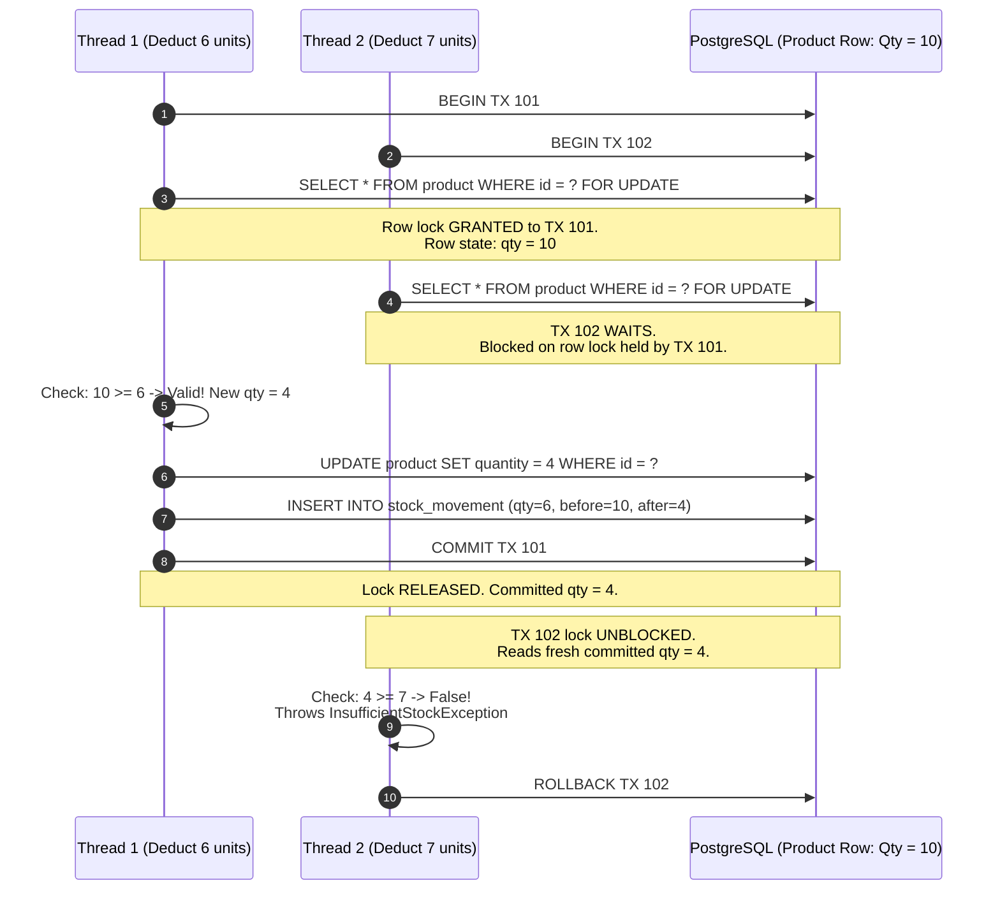
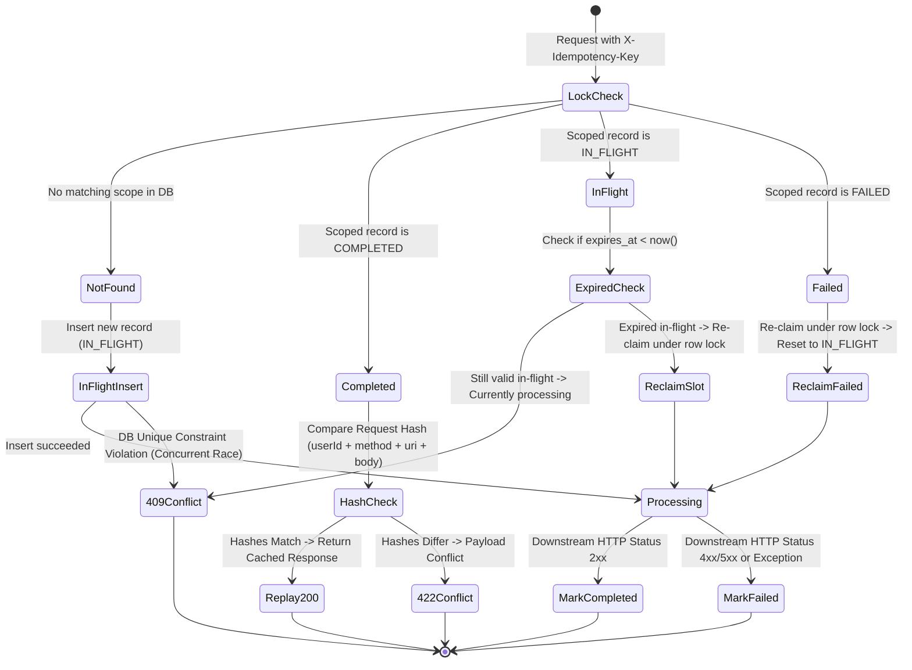
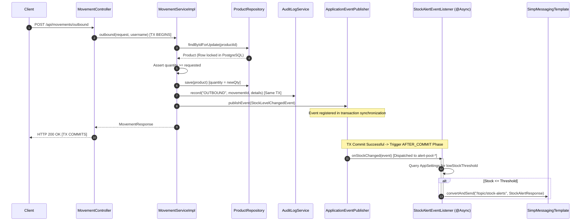
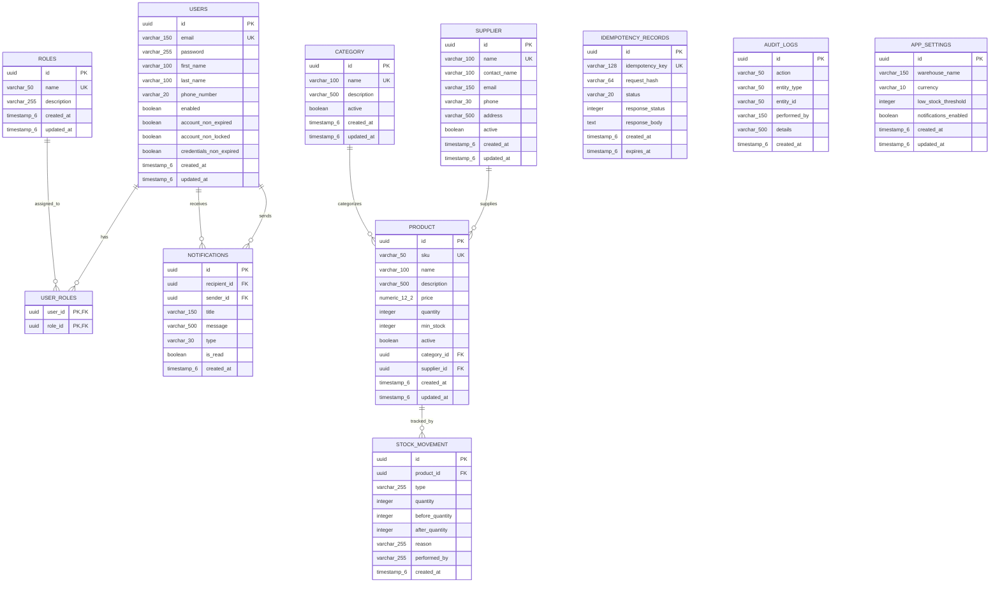

# Low-Level Design (LLD) - Smart Warehouse Management Engine

## 1. Class & Package Architecture

The codebase follows Domain-Driven Design (DDD) layered architecture principles under package [`com.dishan.warehouse`](file:///d:/Warehouse/src/main/java/com/dishan/warehouse/).

```
com.dishan.warehouse
├── auth/                       # Security, JWT filters, authentication service, user options
│   ├── config/                 # SecurityConfig (FilterChain, Provider, PasswordEncoder)
│   ├── controller/             # AuthController (/api/auth)
│   ├── dto/                    # AuthResponse, LoginRequest, RegisterRequest
│   ├── security/               # JwtService, JwtAuthenticationFilter, CustomUserDetailsService
│   └── service/                # AuthenticationService, UserDetailsService
├── category/                   # Category entity, controller, service, mapper
├── config/                     # AsyncConfig (ThreadPoolTaskExecutor), OpenApiConfig
├── dashboard/                  # Dashboard statistics projections & aggregation controller
├── entity/                     # JPA Entities (Product, StockMovement, User, Role, AuditLog, AppSettings)
├── exception/                  # GlobalExceptionHandler, Custom Exceptions (InsufficientStockException)
├── idempotency/                # Idempotency Engine
│   ├── entity/                 # IdempotencyRecord, IdempotencyStatus
│   ├── exception/              # IdempotencyConflictException (422), IdempotencyInProgressException (409)
│   ├── filter/                 # IdempotencyFilter, CachedBodyHttpServletRequest
│   ├── repository/             # IdempotencyRepository
│   └── service/                # IdempotencyService (REQUIRES_NEW transactions)
├── movement/                   # Stock Movements Engine
│   ├── controller/             # MovementController (/api/movements)
│   ├── dto/                    # MovementRequest, MovementResponse
│   ├── event/                  # StockLevelChangedEvent, StockAlertEventListener
│   ├── mapper/                 # MovementMapper
│   ├── repository/             # StockMovementRepository
│   └── service/                # MovementService, MovementServiceImpl (Pessimistic Locking)
├── notification/               # WebSocket alert DTOs, messaging service
├── product/                    # Product CRUD, low-stock threshold queries, repository
├── report/                     # CSV & analytics export services
├── settings/                   # Warehouse global configuration (low stock threshold, notifications)
├── supplier/                   # Supplier management
├── user/                       # User administrative management (ADMIN tier)
└── websocket/                  # WebSocketConfig (STOMP message broker registration)
```

---

## 2. Concurrency Model Deep-Dive

### 2.1 Why Pessimistic Locking Over Optimistic Locking
In a high-turnover warehouse where multiple warehouse workers or scanners simultaneously deduct stock for popular items:
- **Optimistic Locking (`@Version`)**: Detects concurrent updates during commit by checking version counter. When conflict occurs, Spring throws `OptimisticLockingFailureException`. The application must abort and retry the entire transaction. Under high contention (e.g., flash sales or rapid warehouse dispatches), this causes **retry storms, thread saturation, and high transaction abort rates**.
- **Pessimistic Write Locking (`PESSIMISTIC_WRITE`)**: Directs PostgreSQL to acquire an exclusive row lock (`SELECT ... FOR UPDATE`) at the SQL level the instant the row is retrieved. Concurrent transactions attempting to lock the same row will wait in the database lock queue until the first transaction commits or rolls back. **Zero aborted transactions, deterministic execution order, and guaranteed inventory integrity**.

### 2.2 SQL Generated & Lock Acquisition
In [`ProductRepository.java`](file:///d:/Warehouse/src/main/java/com/dishan/warehouse/product/repository/ProductRepository.java):
```java
@Lock(LockModeType.PESSIMISTIC_WRITE)
@Query("SELECT p FROM Product p WHERE p.id = :id")
Optional<Product> findByIdForUpdate(@Param("id") UUID id);
```

Under PostgreSQL, Hibernate generates:
```sql
SELECT p1_0.id, p1_0.name, p1_0.price, p1_0.quantity, p1_0.min_stock, ...
FROM product p1_0
WHERE p1_0.id = ?
FOR UPDATE;
```

### 2.3 Concurrency Execution Sequence



---

## 3. Idempotency Engine Architecture

### 3.1 Idempotency Scope and State Machine

To prevent cross-user and cross-endpoint key collisions, idempotency records are strictly scoped by a composite database uniqueness constraint:
`(user_id, http_method, request_uri, idempotency_key)`



### 3.2 Pessimistic Lock Recovery on Expired and Failed Keys
When re-claiming an expired `IN_FLIGHT` record or retrying a `FAILED` record, concurrent requests could race if read without row locks.

To eliminate this race:
1. `IdempotencyRepository.findForUpdate(...)` queries PostgreSQL using `@Lock(LockModeType.PESSIMISTIC_WRITE)`:
   ```sql
   SELECT r FROM idempotency_records r 
   WHERE r.user_id = ? AND r.http_method = ? AND r.request_uri = ? AND r.idempotency_key = ? 
   FOR UPDATE;
   ```
2. The first thread acquires the exclusive row lock in PostgreSQL.
3. If the record is expired `IN_FLIGHT` or `FAILED`, the winning thread updates the status to `IN_FLIGHT`, refreshes `expires_at` to `now() + 24h`, flushes changes, and commits.
4. When subsequent threads acquire the row lock, they read the fresh committed state: status is now `IN_FLIGHT` with a future expiration timestamp.
5. Subsequent threads immediately throw `IdempotencyInProgressException` (HTTP 409 Conflict), guaranteeing that exactly one request recovers and executes business logic.

### 3.3 Request Caching and Servlet Stream Handling
Under standard Java Servlet specifications, `request.getInputStream()` can only be read once. If a filter reads the input stream to compute a hash, Spring MVC `@RequestBody` deserialization fails with `HttpMessageNotReadableException`.

To solve this:
1. [`CachedBodyHttpServletRequest`](file:///d:/Warehouse/src/main/java/com/dishan/warehouse/idempotency/filter/CachedBodyHttpServletRequest.java): Reads `request.getInputStream().readAllBytes()` once into memory, caching `byte[] cachedBody`. Overrides `getInputStream()` and `getReader()` to supply fresh `ByteArrayInputStream` instances on demand.
2. `ContentCachingResponseWrapper`: Wraps `HttpServletResponse` during downstream execution. Once the controller produces output, the wrapper captures the response byte stream, status code, and headers without prematurely writing to the network socket.
3. [`IdempotencyFilter`](file:///d:/Warehouse/src/main/java/com/dishan/warehouse/idempotency/filter/IdempotencyFilter.java):
   - Computes request hash scoped to `userId:httpMethod:requestUri:bodyBytes`.
   - Status 2xx: Caches payload in `idempotency_records` table, transitions to `COMPLETED`, calls `responseWrapper.copyBodyToResponse()`.
   - Status 4xx/5xx: Calls `idempotencyService.fail(userId, httpMethod, requestUri, key)` to allow retry, calls `responseWrapper.copyBodyToResponse()`.

### 3.4 Transaction Isolation with `REQUIRES_NEW`
In [`IdempotencyService.java`](file:///d:/Warehouse/src/main/java/com/dishan/warehouse/idempotency/service/IdempotencyService.java):
All idempotency status mutations run inside `@Transactional(propagation = Propagation.REQUIRES_NEW)`.
This isolates the idempotency audit record from the main application business transaction:
- If the stock deduction business transaction rolls back due to a business exception, the `IdempotencyRecord` status update to `FAILED` is not rolled back, permitting subsequent client retries.
- When `IN_FLIGHT` is saved, it commits immediately to PostgreSQL so any competing concurrent thread will instantly see the locked slot.

---

## 4. Transaction Boundaries & Event Lifecycles

### 4.1 Execution Sequence: Movement Service with Post-Commit Event Dispatch



### 4.2 Why This Prevents Ghost WebSocket Alerts
In naive implementations where `SimpMessagingTemplate.convertAndSend(...)` is invoked directly within `MovementServiceImpl.outbound()`:
- If `auditLogService.record(...)` fails or a database constraint is violated during commit, the database transaction rolls back.
- However, the TCP WebSocket packet has **already been sent over the network** to connected browser clients!
- Warehouse operators see a "LOW STOCK" alert on their dashboard, yet the database contains the original stock level.
- **Solution**: `@TransactionalEventListener(phase = TransactionPhase.AFTER_COMMIT)` ensures the listener method is invoked **only after** PostgreSQL returns a successful commit confirmation packet to the JDBC driver.

---

## 5. Database Schema & Entity-Relationship (ER) Diagram


